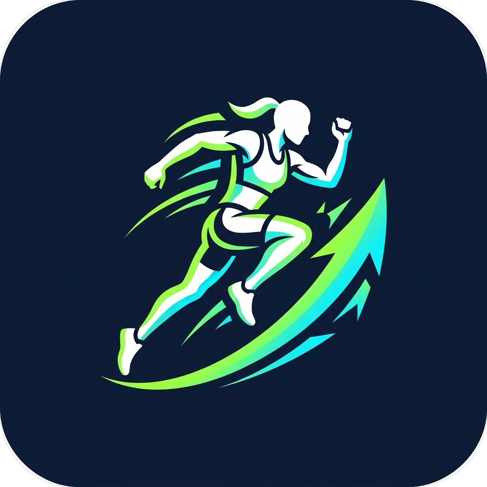
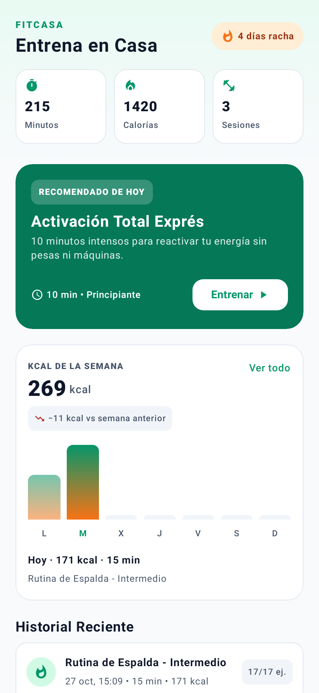
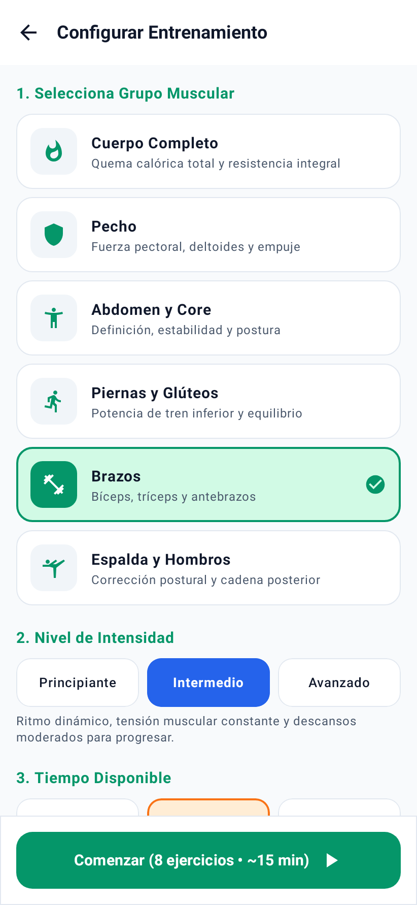
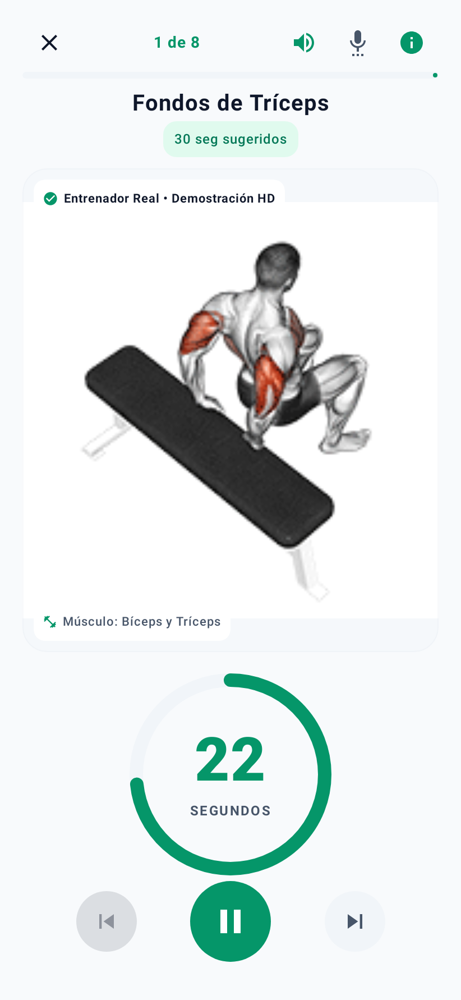
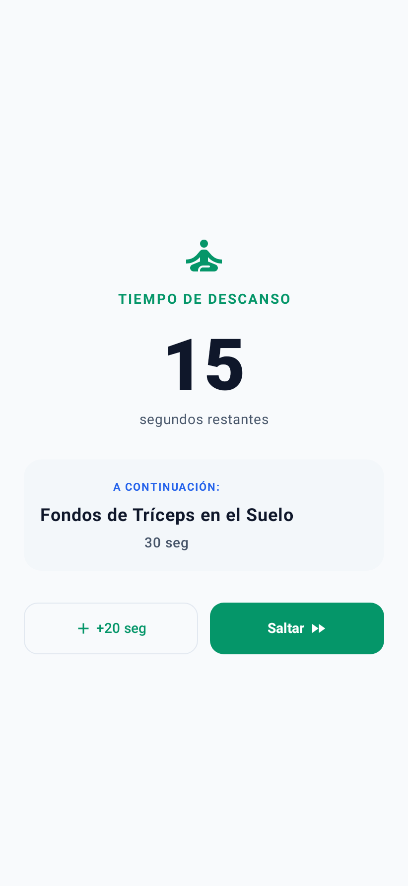
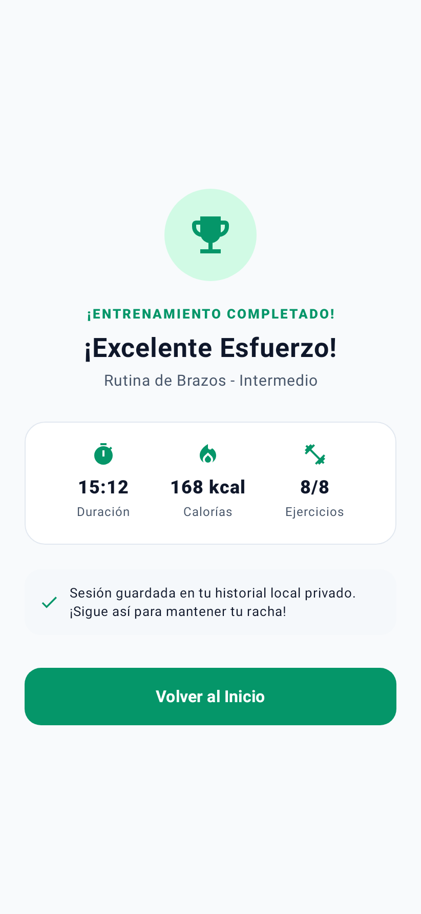
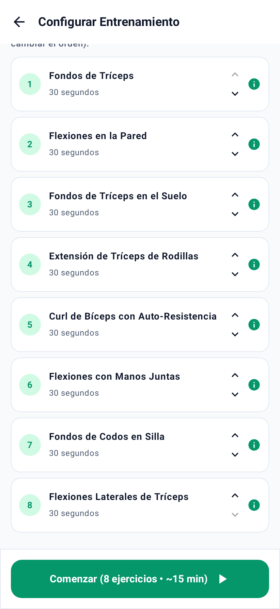

# FitCasa

<p align="center">
  
</p>

App Android de entrenamiento en casa **sin equipamiento**: rutinas por zona del cuerpo, nivel y tiempo disponible, temporizador con descansos, demostraciones de técnica y seguimiento local del progreso.

## Capturas

<table>
  <tr>
    <td align="center" width="33%"><br><sub>Inicio</sub></td>
    <td align="center" width="33%"><br><sub>Configurar</sub></td>
    <td align="center" width="33%"><br><sub>Entrenamiento</sub></td>
  </tr>
  <tr>
    <td align="center" width="33%"><br><sub>Descanso</sub></td>
    <td align="center" width="33%"><br><sub>Resumen</sub></td>
    <td align="center" width="33%"><br><sub>Lista de ejercicios</sub></td>
  </tr>
</table>

## Qué incluye

- **Inicio**: racha de días, minutos y calorías acumuladas, acceso rápido a zonas del cuerpo e historial reciente.
- **Rutinas**: configuración en 3 pasos (zona, intensidad y duración), generación del plan y lista de ejercicios con instrucciones.
- **Entrenamiento activo**: cronómetro circular, descansos con opción de saltar o añadir 20 s, vibración, pantalla siempre encendida y entrenador por voz.
- **Progreso**: historial local con Room (sin registro ni cuenta) y borrado de sesiones.

## Catálogo de ejercicios

33 ejercicios sin equipamiento, todos con demostración **empaquetada en la app** (funciona sin conexión) y una animación biomecánica vectorial como respaldo: 4 de cuerpo completo, 3 de pecho, 3 de abdomen, 4 de piernas, 9 de brazos y 10 de espalda.

Cada demostración está verificada contra el nombre real del movimiento en el dataset de origen, para que coincida con el ejercicio y no requiera máquinas.

**Créditos:** las demostraciones en GIF son propiedad de Gym visual (https://gymvisual.com/) y se distribuyen a 180×180 px según su licencia. Ver `app/src/main/assets/exercises/NOTICE.txt`.

**Animaciones vectoriales:** los ejercicios ya migrados usan animaciones de LottieFiles bajo la *Lottie Simple License* (permite uso comercial), con los PNG originales incrustados en el propio JSON. Ver `app/src/main/assets/exercises/lottie/NOTICE.txt`.

## Estimación de calorías

Cada ejercicio tiene un valor **MET** (Compendium of Physical Activities) convertido a kcal/min con un peso de referencia de 70 kg. La estimación de la sesión suma el tiempo activo al ritmo de cada ejercicio más un ritmo suave de recuperación durante los descansos. Así, entrenar piernas o cuerpo completo estima más gasto que entrenar brazos o core, en lugar de dar el mismo número genérico para todo.

Es una estimación orientativa (no usa tu peso real); sirve para comparar sesiones entre sí.

## Voz del entrenador

- Usa el motor de voz de Google si está instalado y, si no, el motor del sistema.
- Elige automáticamente la mejor voz en español disponible (prefiere voces instaladas, sin conexión y de mayor calidad).
- Atenúa la música del teléfono mientras habla.
- Durante el entrenamiento, el icono de ajustes de voz permite cambiar de voz, ajustar la velocidad (pausada / natural / enérgica) y probarla.
- La preferencia de voz, velocidad y activación se guarda entre sesiones.
- Si faltan las voces en español, la app ofrece un botón para descargarlas.

Para que suene bien, instala las voces en español desde **Ajustes del teléfono › Idiomas y entrada › Salida de texto a voz**.

## Cómo ejecutarlo

**Requisitos:** Android Studio (JDK y SDK de Android).

1. Abre Android Studio y elige **Open** sobre la carpeta del proyecto.
2. Deja que Gradle sincronice y corrija incompatibilidades si hace falta.
3. Ejecuta en un emulador o dispositivo con Android 7.0 (API 24) o superior.

### Instalar el APK sin Android Studio

El APK de depuración se genera con:

```
gradlew assembleDebug
```

Queda en `app/build/outputs/apk/debug/app-debug.apk`. Para instalarlo en el teléfono: copia el archivo, ábrelo y acepta la instalación de orígenes desconocidos. Si ya tenías instalada la versión de AI Studio, desinstálala primero porque la firma es distinta.

> Cada quien compila con su propia firma: si no tienes keystore de depuración, Android Studio/Gradle genera uno automáticamente. La app de ejemplo se firma con `debug.keystore` incluido en la configuración; puedes eliminar la línea `signingConfig = signingConfigs.getByName("debugConfig")` del bloque `debug` de `app/build.gradle.kts` para usar el keystore por defecto de tu máquina.

## Sin servicios externos

La app **no usa Firebase, ni cuentas, ni claves de API**: todo funciona en el teléfono y sin conexión (rutinas, GIFs, voz, historial). La única parte que necesita internet es la descarga de voces en español del sistema.

## Estructura

```
app/src/main/java/com/example/
├── data/           modelos, catálogo de ejercicios, Room y repositorios
├── ui/             pantallas, componentes, tema y ViewModels
└── util/           entrenador por voz (WorkoutVoiceCoach)
```
